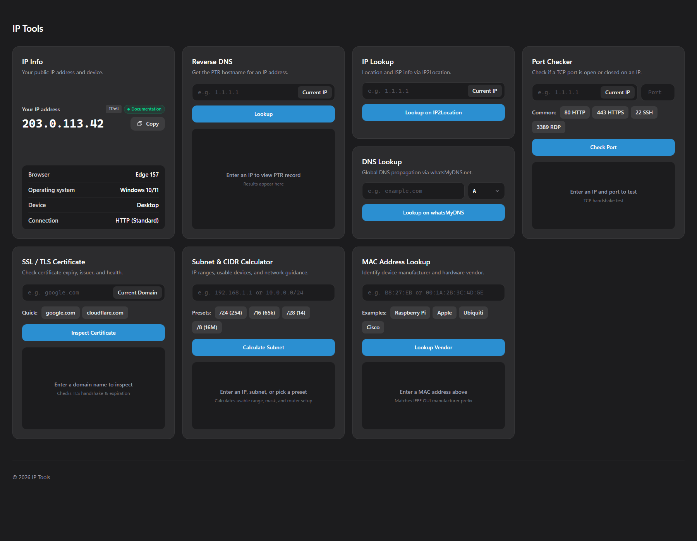

# IP Tools

A lightweight PHP and JavaScript dashboard for common IP and network lookups.



The screenshot displays `203.0.113.42`, a reserved documentation address, instead of a real visitor IP.

## Features

- Displays the visitor's detected IP address and basic browser, operating system, and device information.
- Looks up reverse DNS (PTR) records for public IP addresses.
- Opens IP location and DNS propagation lookups through IP2Location and whatsMyDNS.
- Checks one TCP port on a public IPv4 or IPv6 address.
- Inspects a host's SSL/TLS certificate, including its issuer, expiry, and subject alternative names.
- Calculates IPv4 subnet and CIDR details in the browser.
- Looks up MAC address vendors using a small built-in OUI table with an external fallback.

## Requirements

- PHP with the OpenSSL extension enabled.
- Node.js and npm to rebuild the Tailwind CSS bundle.

## Run locally

From the repository root, build the CSS and start PHP's development server:

```sh
npm install
npm run build
php -S localhost:8000 -t public
```

Open <http://localhost:8000> in a browser. The development server is for local use; deploy behind a production-ready web server for public hosting.

## Configuration

Adjust `public/inc/config.php` for the deployment environment. The `trusted_proxies` list controls which reverse proxies may supply the visitor IP through forwarding headers. Only add proxies you control. API lookups are limited per visitor; the default is 30 requests per 60 seconds.

The web root should point to the `public/` directory. The `public/inc/.htaccess` file denies direct web access to PHP include files on Apache.

## External services and privacy

- IP location and DNS propagation searches open the IP2Location and whatsMyDNS websites in a new tab.
- MAC vendor lookups may query `api.maclookup.app` when a prefix is not in the built-in table.
- IP addresses entered for reverse DNS, port checks, and certificate inspection are processed by the PHP server. Port and certificate checks make outbound network connections from that server.

## Optional logo

The app ships without a logo. If you want to add one, place an SVG or other web image under `public/assets/img/` and update the header markup in `public/index.php` to reference it.

## License

This project is licensed under the MIT License. See [LICENSE](LICENSE).
